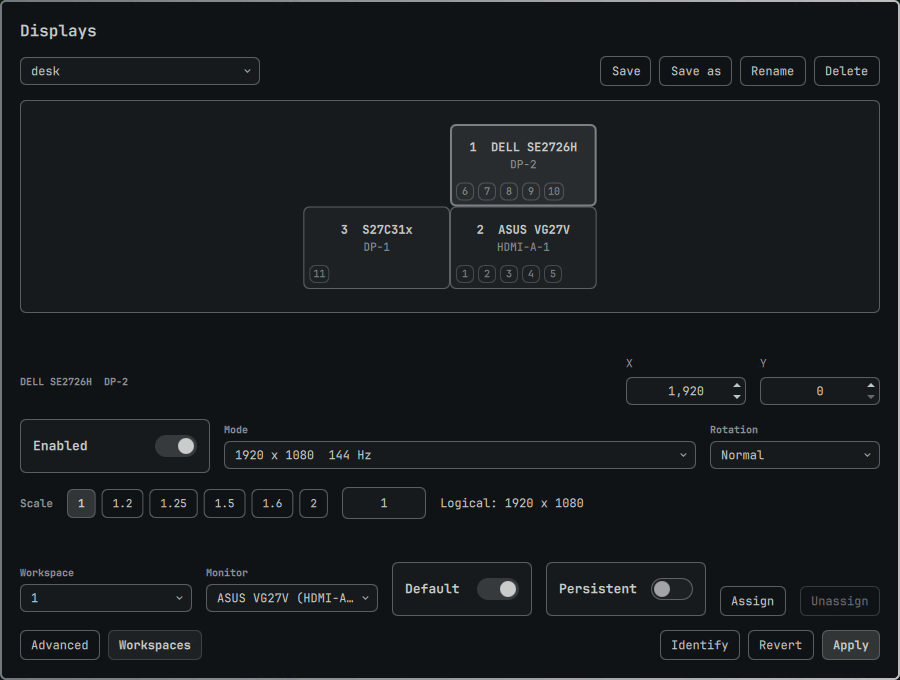

# omarchy-displays

A display-settings panel for [Omarchy](https://omarchy.org). It draws your
monitors to scale, lets you drag them into place and set mode, scale, rotation,
mirror, VRR, bit depth and colour per monitor, then applies the layout with a
keep-or-revert countdown.



Layouts are saved as named profiles keyed by monitor identity (make, model,
serial), not by connector. When the monitors you plug in match a saved profile,
it is applied without opening the panel.

The panel is an Omarchy shell plugin. Everything that touches Hyprland or disk
lives in one bash CLI, `omarchy-displays`, which needs only bash, coreutils,
`jq` and `hyprctl`, so it also works from a TTY when the shell is down.

## Install

Omarchy 4 on Hyprland 0.55 or later (Lua config) is required.

```bash
git clone https://github.com/TheAmbitiousCorry/omarchy-displays
cd omarchy-displays && ./install.sh
```

`install.sh` is safe to re-run. It changes:

- `~/.config/omarchy/plugins/kr34t1v.displays`, a symlink to `plugin/`, and enables it.
- `~/.local/bin/omarchy-displays`, a symlink to `bin/omarchy-displays`.
- `~/.local/share/applications/omarchy-displays.desktop`, a symlink, so the launcher lists Displays.
- `~/.config/omarchy/plugins/kr34t1v.monitor`, a clone of the stock Display bar widget with a Configure button added.
- `~/.config/omarchy/extensions/omarchy-menu.jsonc`, where a marked block turns Setup > Monitors into a submenu with Displays and Edit monitors.lua. Your comments and entries stay as they are.
- `~/.config/hypr/hyprland.lua`, where it adds one line, `pcall(require, "hypr.displays")`, after your requires and before `default.hypr.toggles`. It backs the file up to `hyprland.lua.bak.<epoch>` first.
- `~/.config/hypr/displays.lua`, generated, written empty on a first install.

It ends by reloading Hyprland and running `omarchy-displays doctor`. Your
`~/.config/hypr/monitors.lua` is never read or written.

If you add the plugin with `omarchy plugin add <git url>` instead, the shell
copies the files but never runs an install hook, so none of the above happens.
Finish the install by running `./install.sh` from the clone that `omarchy plugin
add` made in `~/.config/omarchy/plugins/kr34t1v.displays`.

## Use

Open the panel any of these ways:

- Setup > Monitors > Displays in the Omarchy menu.
- Configure, at the foot of the bar's Display widget.
- Type "displays" or "monitor" in the launcher (Super+Space).
- `omarchy-shell shell summon kr34t1v.displays '{}'`

Drag a monitor, or select it and nudge it with the arrow keys (10 pixels, 1 with
Shift). Edges and corners snap. Press Apply: the change goes live at once and a
countdown starts. Press Keep to save it, or Revert (or do nothing for 15
seconds) to go back. The countdown runs in the CLI, so closing the panel or
crashing the shell does not strand a bad layout.

Profiles sit above the canvas: Save, Save as, Rename and Delete. Keep saves the
canvas over the selected profile and writes `displays.lua`. A saved profile also
carries workspace assignments, set from the Workspaces button.

Hotplug needs no action. Two seconds after a monitor is added or removed, the
service applies the stored profile whose monitors match the connected set and
sends a notification. With no matching profile it does nothing.

## CLI

Every command is `omarchy-displays <command>`. `omarchy-displays help` prints
this list.

- `omarchy-displays state`: connected monitors as JSON, each with a derived identity
- `omarchy-displays workspaces`: workspace-to-monitor rules as JSON, plus existing workspaces that have no rule
- `omarchy-displays apply PROFILE.json [--timeout N]`: apply live, then revert after N seconds (default 15) unless confirmed
- `omarchy-displays confirm`: keep the applied layout
- `omarchy-displays revert`: reload the Hyprland config, undoing any unconfirmed change
- `omarchy-displays status`: the live countdown as JSON: pid, deadline, seconds remaining
- `omarchy-displays persist [PROFILE.json]`: write displays.lua from a profile (default: the last applied, else the active) and reload
- `omarchy-displays profile list`: saved profiles as JSON: name, active, identities, modified
- `omarchy-displays profile show NAME`: one saved profile
- `omarchy-displays profile save FILE [--name N] [--activate]`: store a profile, optionally making it the active one
- `omarchy-displays profile delete NAME`: remove a saved profile
- `omarchy-displays profile activate NAME`: mark a saved profile as the active one
- `omarchy-displays profile match`: print the saved profile whose monitors are exactly the connected ones; exit 1 if none
- `omarchy-displays hotplug`: apply and persist the saved profile that matches the connected monitors, if any
- `omarchy-displays doctor`: check that hyprland.lua loads displays.lua and the running config has it
- `omarchy-displays loader-line`: print the line hyprland.lua must contain
- `omarchy-displays version`: print the version
- `omarchy-displays help`: this text

From a TTY, `omarchy-displays revert` reloads the config and undoes an
unconfirmed change. Exit codes are in `docs/context/displays.md`.

## How it works

- **Loader line.** `hyprland.lua` gets `pcall(require, "hypr.displays")`. The `pcall` means a broken `displays.lua` is reported by `hyprctl configerrors` and nothing else in your config fails to load.
- **displays.lua.** The CLI generates it from your profiles. It loads after `monitors.lua`, so its rules win, and before Omarchy's laptop-disable toggle, so that still wins. Every monitor in every profile keeps a rule in the file, so a monitor that is unplugged today still has its settings tomorrow. The last 10 backups (`displays.lua.bak.<epoch>`) are kept.
- **Identity matching.** A monitor is `desc:<make> <model> <serial>`, or `desc:<make> <model>` with no serial. Swapping a cable never puts a rule on the wrong screen. Two identical monitors with no serial fall back to connector names, and the panel warns.
- **One writer.** Lua generation, identity derivation and profile matching live only in the CLI. The panel and the hotplug service call it and nothing else. `apply` (through `hyprctl eval`) and `persist` (into the file) take their rule lines from the same code.
- **Lock.** While a countdown runs, `$XDG_RUNTIME_DIR/omarchy-displays/countdown` exists. `apply` and `hotplug` refuse to run, so a second change or a hotplug profile never fights one you have not confirmed.

Profiles are JSON under `~/.config/omarchy/displays/profiles/`, one file per
name. The schema, exit codes and command semantics are in
`docs/context/displays.md`.

## Caveats

- **Scale presets.** The stock Display widget's scale presets write `monitors.lua`. While a profile covers a monitor, `displays.lua` overrides that, so the presets have no visible effect on it. Change scale in the panel instead.
- **The widget clone stops tracking upstream.** `kr34t1v.monitor` is a copy of the Display widget as of your Omarchy version. To refresh it after an Omarchy update, run `rm -rf ~/.config/omarchy/plugins/kr34t1v.monitor` and then `./install.sh`. If the patch no longer applies, `install.sh` stops and says so.
- **Identical monitors.** Two monitors with the same make and model and no serial match by connector, so a swapped cable swaps their rules.
- **VRR.** `hyprctl` reports `vrr` as a boolean, not the mode (0 to 3). The panel takes the mode you picked as authoritative and falls back to the boolean, so a monitor configured with mode 2 that reads `false` outside fullscreen is written back as 0 on the next Apply unless you pick a mode.
- **Editing the plugin.** The shell does not see edits under `plugin/` through the symlink. Run `omarchy restart shell` after changing them.
- **Hotplug tested with a virtual output.** The unplug-and-replug path was verified with `hyprctl output create headless`, not a cable.

## Uninstall

```bash
./uninstall.sh
```

It removes what `install.sh` added: the loader line (the file ends byte-identical
to its backup from before the install), `displays.lua` and its backups, the
three symlinks, the menu block, and the widget clone, which puts the stock
Display widget back in the same bar position. The clone's folder is moved to a
hidden `.kr34t1v.monitor.bak.<timestamp>` folder in `~/.config/omarchy/plugins/`
rather than deleted. It finishes with `hyprctl reload` and prints `hyprctl
configerrors`.

Your profiles stay in `~/.config/omarchy/displays/` and your monitors keep their
layout, since `monitors.lua` still holds it. `./uninstall.sh --purge` deletes the
profiles too. The `hyprland.lua.bak.<epoch>` and `omarchy-menu.jsonc.bak.<epoch>`
files that `install.sh` made stay where they are.

## Tests

```bash
test/omarchy-displays-test.sh
node plugin/model.test.js
test/readme-test.sh
```

The first runs the CLI against a fake `hyprctl`, so no case reaches your
monitors. The second tests the pure geometry and validation code in
`plugin/Model.js`. The third fails when the README's install block or CLI list
drifts from `install.sh` or `omarchy-displays help`.

## Licence

MIT. `patches/configure-button.patch` modifies the Omarchy Display widget, also
MIT, Copyright (c) David Heinemeier Hansson. See NOTICE.
